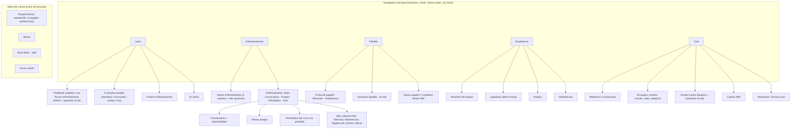

# 02 · Arquitectura de información

Estado comprobado el 15/10/2026 en local (capitán, miembro y cuenta sin club). Los IDs H-xx
remiten a [01-ux-findings.md](01-ux-findings.md).

## 1. Organización actual

### Quién usa Zyra y para qué

| Perfil | Tarea frecuente | Frecuencia (supuesta, C3) | Dónde la hace hoy |
|---|---|---|---|
| Capitán | Preparar el enfrentamiento (crear, convocar, alinear) | Semanal | Partidos › partido |
| Capitán | Apuntar resultados y cerrar acta | Semanal, desde el móvil | Partidos › partido › cada partido |
| Capitán | Mantener la plantilla y los rivales | Mensual | Jugadores, Equipos, Gestionar… |
| Capitán | Invitar jugadores, SNP | Al empezar la temporada | Menú de cuenta |
| Miembro (jugador) | Saber si juega, con quién y dónde | Semanal | Inicio (solo el próximo partido) y Partidos |
| Miembro | Ver sus estadísticas | Ocasional | Estadísticas › Jugador |
| Persona nueva | Registrar el club o unirse | Una vez | Portada → Registro |

### Mapa actual (capitán)

```mermaid
flowchart TB
    subgraph Nav["Navegación principal (escritorio / barra móvil en otro orden)"]
        I[Inicio]
        P[Partidos]
        J[Jugadores]
        E[Equipos]
        S[Estadísticas]
    end
    subgraph Cuenta["Menú del botón con el nombre del club"]
        MP[Mi perfil]
        MI[Miembros del club]
        SNP[Cuenta SNP]
        AB[Abandonar el club]
        BO[Back-office · staff]
        CS[Cerrar sesión]
    end
    I --> PP[Primeros pasos]
    I --> PX[Próximo partido]
    I --> RA[En racha]
    P --> NP[Crear partido]
    P --> RP["Resumen del partido"]
    RP --> CC[Crear / editar convocatoria]
    RP --> PEN["Penalizaciones → Cambios en la convocatoria + Aplicar sanciones"]
    RP --> CP["Crear partidos (parejas)"]
    RP --> RES["Resultado de cada partido (5 páginas)"]
    RP --> PDF[Informe PDF / Reenviar]
    J --> FJ[Ficha del jugador]
    J --> GP[Gestionar plantilla]
    J --> CJ[Crear / editar jugador]
    J -.solo vía Primeros pasos o error.-> CT[Completar equipo SNP]
    E --> GE[Gestionar equipos]
    E --> CE[Crear / editar equipo · incluye el propio]
    S --> SE[Equipo]
    S --> SJ[Jugador]
    S --> SP[Parejas]
    S --> SA[Advertencias]
    MP --> MJ[Mi jugador]
```

### Lo que funciona

- Cinco secciones en la navegación principal: número manejable y con nombres del dominio.
- El enfrentamiento es la entidad central y todo su ciclo cuelga de una sola página.
- Estadísticas agrupadas en una sección con pestañas.

## 2. Problemas de estructura

| # | Problema | Evidencia | Hallazgo |
|---|---|---|---|
| E1 | Un mismo término para dos niveles («Partidos» = enfrentamientos y también los 5 partidos de cada uno) | Página del partido, estadísticas | H-01 |
| E2 | Configuración del club mezclada con la cuenta personal, detrás de un botón etiquetado con el nombre del club | Cabecera | H-14 |
| E3 | «Equipos» mezcla el equipo propio (configuración) con los rivales (catálogo para crear partidos) | Listado de equipos | H-38 |
| E4 | El jugador está partido en Ficha (Jugadores) y Estadísticas › Jugador, sin enlace de vuelta | Ficha y estadísticas | H-25 |
| E5 | El inicio es una agenda, no un panel de trabajo: lo pendiente no aparece | Inicio | H-02 |
| E6 | El rol miembro no tiene un espacio propio: ve lo mismo que el capitán sin botones | Inicio del miembro | H-06 |
| E7 | Las sanciones viven dentro del «registro de cambios» de la convocatoria, a la que se llega con un botón llamado «Penalizaciones» | Partido → `/callLog/…` | H-07, H-35 |
| E8 | Orden de la barra móvil distinto al de escritorio | Cabecera / barra inferior | H-13 |

## 3. Contenido duplicado

| Dato o función | Dónde aparece | Tipo | Recomendación |
|---|---|---|---|
| Balance del equipo (V-E-D, %) | Estadísticas: cifra grande, «Partidos ganados %», gráfico circular | Duplicación innecesaria | Dejar la cifra; quitar el circular (H-16) |
| Juegos como local/visitante | Tarjeta numérica + gráfico de barras con % | Duplicación innecesaria | Quedarse con uno |
| Email del capitán | «Mi perfil» (con contraseña) y tabla de «Miembros» (sin contraseña) | Duplicación con reglas distintas | Solo en «Mi perfil» (H-23) |
| Pertenencia al equipo (`in_team`) | Editar jugador y «Gestionar plantilla» | Repetición útil (individual y en lote) | Mantener ambos, misma etiqueta |
| Datos del jugador | Ficha, Estadísticas › Jugador, Mi perfil › Mi jugador, Editar mi jugador | Información repartida | Una ficha con pestañas (H-25) |
| Registrar cuenta SNP | Paso de «Primeros pasos» y tarjeta propia en el inicio | Repetición útil (la tarjeta solo sale al ocultar los pasos) | Mantener |
| «Datos del informe PDF» | Crear partido y Mi perfil | Repetición útil (por defecto y por partido), mal situada | Pasar la opción del partido a la pantalla del informe (H-11) |
| Puntos SNP | Tarjeta de jugador, ficha, ranking SNP, alineación | Repetición útil, con 4 formatos | Un formato (H-18) |
| Estado del enfrentamiento | Insignias «Sin validar», «Abierta/Cerrada», «Acta cerrada», estado de tarjeta «Sin resultado/Pdt. cerrar acta» | Datos equivalentes mostrados distinto | Un único vocabulario de fases (H-03) |
| Próximo partido | Inicio y Partidos | Repetición útil | Mantener; excluir actas cerradas (H-36) |

## 4. Información ausente

| Flujo | Falta | Tipo | Hallazgo |
|---|---|---|---|
| Inicio del capitán | Enfrentamientos pasados sin acta, convocatorias por cerrar | Ausente | H-02 |
| Inicio del miembro | «¿Estoy convocado? ¿Con quién juego?» | Ausente | H-06 |
| Convocar | Disponibilidad, SNP, partidos jugados, advertencias visibles | Ausente / escondida en `title` | H-05, H-29 |
| Crear partido | Hora y lugar editable | Ausente | H-11 |
| Cerrar convocatoria | Aviso de que se enviará el PDF y a quién; cuántos faltan | Aparece tarde (después de pulsar) | H-10 |
| Resumen del partido | Victoria / Derrota | Ausente | H-21 |
| Cerrar acta | Confirmación con el marcador y qué cambia | Ausente | H-40 |
| Sanciones | Motivo, forma de deshacer | Ausente | H-07 |
| Alineación | Qué pareja juega qué partido mientras se edita (móvil) | Difícil de encontrar | H-31 |
| Estadísticas | Qué temporada se está viendo al llegar desde Partidos | Ambigua | H-17 |

## 5. Arquitectura propuesta

Principios: (1) un término por concepto; (2) separar **lo que se hace cada semana** (Inicio,
Enfrentamientos) de **lo que se configura** (Club); (3) una entidad, una ficha; (4) mismo orden en
todos los dispositivos.

### Cambios y justificación

| Cambio | Por qué | Implicaciones |
|---|---|---|
| «Partidos» → **Enfrentamientos**; dentro, Partido 1-5 | Elimina la ambigüedad E1 con el vocabulario de SNP | Textos, traducción, PDF, guías; URL sin cambios |
| «Jugadores» → **Plantilla** | Es el nombre que ya usa la app («Gestionar plantilla») y deja claro que son los del club | Solo etiqueta |
| **Equipos sale de la navegación** y pasa a Club como «Rivales» y «Mi equipo» | Los rivales se tocan al empezar la temporada; el hueco en la navegación lo ocupa Club, que se usa más | Los enlaces de «Primeros pasos» y del formulario de partido apuntan a Club › Rivales |
| Nueva sección **Club** | Hace visibles invitaciones y SNP (E2) y agrupa la configuración | Para el miembro, Club muestra miembros (solo lectura) y su jugador |
| Menú de cuenta con icono de persona | Deja de parecer el «menú del club» | `core/templates/base.html` |
| Ficha única de jugador | E4: un sitio por jugador | Estadísticas › Jugador pasa a ser buscador |
| Inicio con «Pendiente» / «Tu próximo partido» | E5 y E6 | Consulta del estado de cada enfrentamiento |
| Advertencias bajo «Más» del enfrentamiento y en Estadísticas | E7 | Sanción separada del registro de cambios |

### Navegación recomendada

- **Escritorio**: barra superior Inicio · Enfrentamientos · Plantilla · Estadísticas · Club, con
  estado activo (ya existe) y `aria-current` también en escritorio.
- **Móvil y tablet** (< 992 px): barra inferior con las mismas cinco entradas, en el mismo orden
  y con texto. En tablet (≥ 768 px) la barra puede llevar icono y texto en línea.
- **Enlaces de vuelta**: todos los formularios con antetítulo de vuelta (ya está en convocatoria,
  alineación y resultado) y además «Cancelar» junto al botón principal (falta en Crear partido).
- **Profundidad máxima**: 3 niveles (Sección › Entidad › Acción). Hoy «Penalizaciones» está en el
  nivel 4 (Partidos › Partido › Registro › Aplicar sanción).

## 6. Riesgos y decisiones de producto pendientes

1. **Término del nivel superior** (Enfrentamiento o Partido): decisión de producto con prueba de
   comprensión (T6 de [05](05-usability-testing-plan.md)).
2. **Mover Equipos a Club** reduce su visibilidad; si las pruebas muestran que los capitanes crean
   rivales a menudo durante la temporada, se puede añadir «Nuevo rival» dentro de «Nuevo
   enfrentamiento» (ya se puede escribir un rival a mano en amistosos).
3. **Disponibilidad (H-05)** cambia el rol del miembro de «solo lectura» a «responde»; requiere
   decidir si un jugador sin cuenta puede responder desde un enlace.
