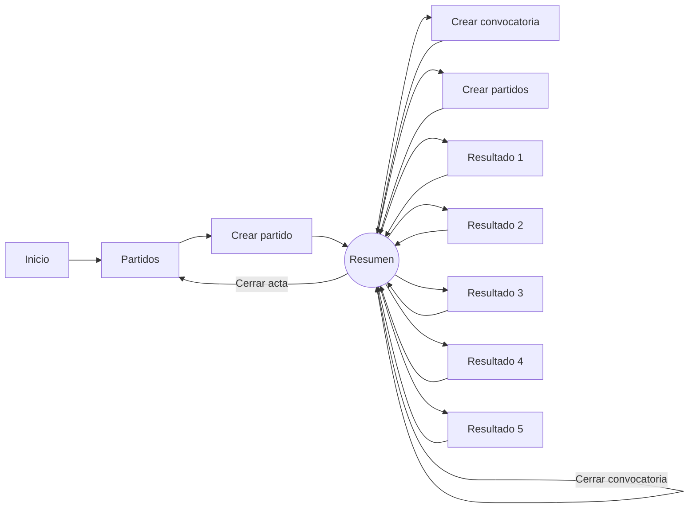
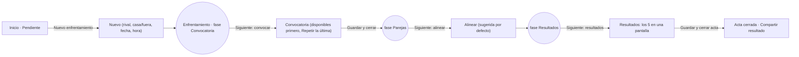

# 03 · Flujos de usuario y accesos rápidos

Los recorridos F1 y los errores de F1 se ejecutaron con Playwright en móvil (390×844) sobre la base
local de prueba. Los recuentos son de la prueba automatizada: **navegaciones** = cargas de página
completas; **interacciones** = toques, selecciones y casillas rellenadas que haría una persona. No
son tiempos de usuarios reales.

## F1 · Ciclo semanal del capitán

Objetivo: preparar y cerrar un enfrentamiento de liga contra un rival del grupo con 12 convocados.

### Recorrido actual (medido)

| Fase | Pantallas | Navegaciones (acum.) | Interacciones (acum.) | Fricción observada |
|---|---|---|---|---|
| Crear partido | Inicio → Partidos → Crear partido → Resumen | 3 | 7 | Modo + Tipo; local/visitante en dos tarjetas; sin hora (H-11) |
| Crear convocatoria (12) | Resumen → Crear convocatoria → Resumen | 5 | 21 | Sin datos para decidir; 2 páginas para 23 jugadores; sin mensaje (H-29, H-08) |
| Cerrar convocatoria | Resumen | 6 | 22 | Botón rojo; envía email sin avisar (H-10) |
| Crear parejas | Resumen → Crear partidos → Resumen | 8 | 25 | Orden de juego al final en móvil (H-31); texto vacío contradictorio antes (H-09) |
| 5 resultados | 5 × (Resumen → Resultado → Resumen) | 18 | 57 | Vuelve arriba, sin confirmación (H-04) |
| Cerrar acta | Resumen → Partidos | 19 | 58 | Sin resumen ni mensaje (H-40) |

**Total: 19 cargas de página y unas 58 interacciones**, de las que 31 son de resultados.



### Puntos de fricción

1. El capitán vuelve 8 veces a la misma página y cada vez busca el siguiente botón (H-03).
2. El resultado de cada partido es un viaje de ida y vuelta (H-04).
3. La información para convocar (disponibilidad, SNP, asistencia) no está en el selector (H-05, H-29).
4. Ninguna fase confirma lo hecho salvo dos (H-08); el cierre del acta no da cierre (H-40).

### Flujo optimizado propuesto



| Fase | Navegaciones | Interacciones | Cambio |
|---|---|---|---|
| Crear | 2 | 5 | Desde «Pendiente» o «Nuevo»; 3 campos obligatorios |
| Convocar y cerrar | 2 | 14 | «Guardar y cerrar» si hay ≥ 10; o «Repetir la última» + ajustes |
| Alinear | 2 | 2 | Sugerida precargada |
| Resultados + acta | 2 | 25 | Una pantalla, un guardado, confirmación con marcador |
| **Total** | **8** | **≈ 46** | −11 cargas de página; −12 interacciones (estimado, no medido) |

Con «Repetir la última convocatoria» la fase de convocar baja de ~14 a ~4 interacciones cuando
la plantilla apenas cambia (hipótesis a validar: frecuencia real de cambios entre jornadas).

### Errores probados en F1

| Situación | Resultado | Hallazgo |
|---|---|---|
| Crear partido sin rival | Burbuja nativa del navegador, en el idioma del navegador y mal colocada | H-12 |
| Crear convocatoria sin jugadores | Popup «Debes seleccionar al menos un jugador.» (correcto) | — |
| Cerrar convocatoria con 3 | Se puede pulsar; popup posterior «al menos debes contar con 10 jugadores» | H-10 |
| Resultados en un partido futuro | Se aceptan y se puede cerrar el acta | H-36 |
| Aplicar una sanción | Sin mensaje; sin forma de deshacer | H-07, H-08 |

## F2 · El miembro quiere saber si juega

| Paso | Hoy | Problema |
|---|---|---|
| 1 | Abre Inicio: ve el próximo partido (fecha, rivales, lugar) | No dice si está convocado |
| 2 | Pulsa «Ver convocatoria» | Debe buscar su nombre entre chips truncados |
| 3 | Baja hasta «Partidos» (si ya hay parejas) | Debe localizar su pareja entre 5 bloques |

Propuesta: tarjeta «Tu próximo partido» en el inicio (H-06): 0 navegaciones adicionales. Con
disponibilidad (H-05): «¿Puedes jugar el domingo 25? Sí · No · Duda» en la misma tarjeta.

## F3 · Invitar a un jugador a mitad de temporada

Hoy: menú con el nombre del club → «Miembros del club» → escribir email → «Enviar invitación»
(o «Generar enlace»). 4 interacciones, pero el primer paso no es descubrible si «Primeros pasos»
está oculto (H-14). Propuesta: Club › Miembros, y botón «Invitar» también en la ficha de un jugador
sin cuenta enlazada («Invitar a este jugador»), que rellena la invitación y la enlaza al aceptar.

## F4 · Ver cómo va una pareja

Hoy: Estadísticas › Parejas › elegir jugador 1 (buscador) › elegir jugador 2 › «Ver pareja». 5-7
interacciones. Desde la página del partido no hay enlace a la pareja de cada partido. Propuesta:
cada pareja del enfrentamiento enlaza a su estadística (0 búsquedas).

## F5 · Alta de un club nuevo

Portada → «Registrarme gratis» → «¿Cómo quieres usar Zyra?» → «Crear mi club» → formulario de
14 campos → inicio con «Primeros pasos» (5 tareas). Riesgo: la pantalla intermedia de elección
añade un paso para el caso más común en la portada, que se dirige a capitanes («La app para
capitanes…»). Propuesta: el botón principal de la portada va directo a «Registrar un club» y la
opción de jugador queda como enlace secundario («¿Te ha invitado tu capitán?»). Formulario en dos
pasos (H-33).

## Accesos rápidos y automatizaciones

Solo se proponen los que encajan en los flujos reales observados.

| # | Tipo | Problema actual | Acción del usuario hoy | Propuesta | Ubicación | Ahorro | Beneficiados | Riesgos / complejidad | Esfuerzo | Métrica |
|---|---|---|---|---|---|---|---|---|---|---|
| A1 | Acceso rápido | El inicio no lleva a lo pendiente | Partidos → buscar → abrir | Fila «Pendiente» con botón de la siguiente acción | Inicio (capitán) | 2 navegaciones por tarea | Capitán | Cálculo de fase compartido con H-03 | M | Actas abiertas > 7 días |
| A2 | Acción rápida en listado | La tarjeta solo abre el partido | Abrir partido → buscar botón | Botón secundario en la tarjeta: «Convocar», «Alinear», «Resultados» | Tarjeta del listado | 1 navegación | Capitán | Tarjeta ya es enlace completo (`stretched-link`): el botón debe ir por encima | S | Clics por tarea |
| A3 | Plantilla / duplicar | Convocar a casi los mismos cada semana | Marcar 10-14 casillas | «Repetir la última convocatoria» | Crear convocatoria | ~10 interacciones | Capitán | Incluir a quien ya no está en el equipo: filtrarlo | S | Interacciones por convocatoria |
| A4 | Automatización | 5 formularios de resultado | 10 navegaciones | Resultados en una pantalla + «Guardar y cerrar acta» | Enfrentamiento | 8-9 navegaciones | Capitán | Validación parcial; reutilizar `match/scoring.py` | M | Tiempo T3 |
| A5 | Valor por defecto | Local siempre = equipo propio | Cambiar 2 tarjetas para jugar fuera | «Jugamos en casa / fuera» + lugar del rival al elegir fuera | Nuevo enfrentamiento | 2-3 interacciones | Capitán | Ninguno relevante | S | Errores local/visitante |
| A6 | Automatización | Disponibilidad por WhatsApp | Preguntar fuera y copiar | Petición de disponibilidad con recordatorio | Nuevo enfrentamiento / inicio miembro | Fuera de la app: alto (hipótesis) | Capitán y miembros | Necesita cuentas o enlace sin sesión; correo | L | % de respuestas |
| A7 | Compartir | Resultado se reescribe a mano en el grupo | Copiar marcador y parejas | «Compartir resultado» (Web Share / texto) tras cerrar acta | Enfrentamiento | ~1-2 min fuera de la app (hipótesis) | Capitán | Ninguno | XS-S | Uso del botón |
| A8 | Persistencia | La temporada vuelve al valor por defecto en cada pantalla | Elegir temporada otra vez | Recordar temporada y tipo en sesión | Partidos y Estadísticas | 1 toque por visita | Todos | Confusión si no se ve qué filtro hay: mostrarlo siempre | XS | — |
| A9 | Enlace directo | Desde un partido no se va a la pareja | Buscar la pareja en Estadísticas | Cada pareja enlaza a sus estadísticas | Enfrentamiento | 5-7 interacciones | Todos | Ninguno | XS | Visitas a parejas |
| A10 | Atajo móvil | Acción principal lejos (abajo) | Desplazarse | Barra de acción fija con «Siguiente: …» | Enfrentamiento (móvil) | Scroll | Capitán | Compite con la barra inferior (H-30) | S | — |

**Descartados por ahora**: atajos de teclado (uso mayoritario en móvil, hipótesis), búsqueda
global (pocas entidades por club; los listados ya tienen buscador), filtros guardados (dos filtros
por pantalla), favoritos (el club tiene un solo equipo propio).

### Riesgos y dependencias generales

- A1, A2 y A10 dependen de un **cálculo único de la fase** del enfrentamiento (una función en
  `match/` que devuelva fase y siguiente acción) para no repetir lógica en plantillas.
- A4 y A7 cambian el final del flujo: conviene hacerlos juntos.
- A6 es estructural y no debe empezar sin validar la hipótesis H2 de [05](05-usability-testing-plan.md).

### Métricas de validación

| Métrica | Fuente | Hoy |
|---|---|---|
| Cargas de página por enfrentamiento cerrado | `RequestMetric` del back-office (por ruta) | Medido en prueba: 19 |
| Días entre la fecha del enfrentamiento y el cierre del acta | `Match.start_date` y fecha de cierre (hay que guardarla) | No se guarda la fecha de cierre |
| % de enfrentamientos pasados con acta abierta | BD | Consultable hoy |
| Visitas semanales de miembros | `UserActivity` | Consultable hoy |
| Tiempo de tareas T1-T3 | Pruebas con usuarios | Sin datos |

## Benchmark

Comparación con productos que resuelven problemas parecidos (consultado el 15/10/2026). Solo se
recogen patrones que responden a un problema detectado aquí.

| Producto | Patrón verificable | Problema de Zyra que resolvería | Adaptación |
|---|---|---|---|
| Spond | Peticiones de disponibilidad enviadas por el entrenador a un grupo, con fecha límite y **recordatorios automáticos** a quien no ha respondido; vista de todas las peticiones en un sitio ([Spond, availability requests](https://www.spond.com/news-and-blog/spond-availability-requests/)) | H-05: el capitán pregunta por WhatsApp | Petición por enfrentamiento, respuesta Sí/No/Duda desde correo o inicio, recordatorio con el programador existente (`backoffice/jobs.py`) |
| TeamSnap | Cada miembro marca su disponibilidad por evento desde la web, la app o el **correo de recordatorio**, con nota opcional; el entrenador ve el historial de asistencia ([TeamSnap, track event availability](https://helpme.teamsnap.com/article/660-track-event-availability)) | H-05, H-29: decidir la convocatoria sin datos | Respuesta desde el propio correo sin iniciar sesión; «Jugó 6 de 8» en el selector |
| TeamSnap | La alineación se construye **a partir de quien ha confirmado** y se puede notificar al equipo al guardarla o más tarde ([TeamSnap, lineup](https://www.teamsnap.com/blog/general-sports/get-your-lineup-ready-feature-friday)) | H-06: el miembro no sabe con quién juega | Al guardar parejas, opción «Avisar a los convocados» y tarjeta «Tu próximo partido» |
| Playtomic | Subir un resultado es un flujo guiado (deporte, jugadores, fecha, lugar, competitivo o no) y **los demás jugadores aceptan el resultado** ([Playtomic, upload results](https://playerhelp.playtomic.com/hc/en-gb/articles/19831532392081-How-to-upload-results-from-matches-played-outside-Playtomic)) | H-04, H-40 | Una sola pantalla de resultados; a medio plazo, que el rival o los jugadores confirmen el acta (no prioritario) |

Patrones que **no** conviene copiar: el muro social y los niveles de Playtomic (Zyra es privado
por club) y la planificación de temporada completa de Spond (las jornadas las fija SNP).

## Propuestas visuales

### Propuesta visual 1 · Inicio del capitán

Distribución actual: cabecera del club · Primeros pasos (5 filas) · Próximo partido · En racha.

```text
┌──────────────────────────────────────────────┐
│ [escudo] LOS GLADIADORES · Temporada 26-27   │  ← cabecera más baja (64 px)
├──────────────────────────────────────────────┤
│ PENDIENTE                                    │  ← NUEVO, primero
│ ● dom 4 oct · vs ATLÉTICO ISLEÑO   [Convocar]│  ← pasado: en rojo
│ ● dom 25 oct · vs ICONICO  8/10    [Cerrar   │
│                                 convocatoria]│
├──────────────────────────────────────────────┤
│ PRÓXIMO ENFRENTAMIENTO  En 10 días · 18:00   │  ← se mantiene, sin actas cerradas
│ LOS GLADIADORES  vs  ATLÉTICO ISLEÑO         │
│ [Cómo llegar]               [Abrir]          │
├──────────────────────────────────────────────┤
│ Primeros pasos · 4 de 5 hechos   [Ver] [×]   │  ← plegado a una línea
├──────────────────────────────────────────────┤
│ EN RACHA  (jugador · pareja)                 │  ← se mantiene
└──────────────────────────────────────────────┘
```

Se mantiene: cabecera, próximo partido, en racha. Se reordena: Pendiente arriba, Primeros pasos
plegado abajo. Móvil: mismas piezas en una columna; «Pendiente» muestra hasta 3 filas y «Ver todo».

### Propuesta visual 2 · Página del partido

Distribución actual: título genérico · marcador · Convocatoria (fila de 5 botones) · chips ·
Partidos (botón propio) · 5 tarjetas · botón de acta al final.

```text
┌──────────────────────────────────────────────┐
│ ← Enfrentamientos                            │
│ LOS GLADIADORES – NORTHPADEL      [Más ▾]    │  ← título con equipos; Más = PDF,
│ dom 27 sep · 18:00 · Salteras                │     reenviar, advertencias, registro,
│        5 – 7   DERROTA                       │     editar fecha, borrar
├──────────────────────────────────────────────┤
│ ①Convocatoria ─ ②Parejas ─ ③Resultados ─ ④Acta │  ← indicador de fases
│ [ Siguiente: poner resultados (3/5) ]        │  ← único botón principal
├──────────────────────────────────────────────┤
│ CONVOCADOS 17  (Derecha 9 · Revés 4 · Mixto 4)│  ← plegable cuando ya hay parejas
├──────────────────────────────────────────────┤
│ PARTIDO 1 · 3 pts   ZURITA / MARTÍNEZ  2-6 6-3 4-6 │ ← fila compacta, pareja enlazada
│ PARTIDO 2 · 3 pts   BUSTAMANTE / DELGADO 7-6 6-2  │
│ …                                            │
└──────────────────────────────────────────────┘
```

Móvil: el botón «Siguiente» va en una barra fija que sustituye a la barra de navegación mientras
el enfrentamiento esté abierto (H-30). La lista de convocados se pliega tras alinear.

### Propuesta visual 3 · Resultados en una pantalla

```text
RESULTADOS · LOS GLADIADORES – ICONICO            Marcador: 7 – 5
┌ Partido 1 · 3 pts · BUSTAMANTE / BIELSA ──────────────┐
│        S1   S2   S3                                   │
│ Local  [6]  [6]  [ ]   ✓ Gana Local                   │
│ Visit. [4]  [3]  [ ]                                  │
└───────────────────────────────────────────────────────┘
┌ Partido 2 · 3 pts · URRACO / ZURITA ─── (vacío) ──────┐
…
[ Guardar ]                   [ Guardar y cerrar acta ]
```

Las casillas pasan solas a la siguiente al escribir dos cifras (`inputmode="numeric"` ya está).
El marcador total se recalcula en vivo. Los partidos sin rellenar no bloquean «Guardar».

### Propuesta visual 4 · Inicio del miembro

```text
┌──────────────────────────────────────────────┐
│ TU PRÓXIMO PARTIDO                           │
│ dom 25 oct · 18:00 · vs ATLÉTICO ISLEÑO      │
│ ✓ Estás convocado · Partido 2 · 3 pts        │
│   con ANTONIO URRACO                         │
│ [Cómo llegar]  [Ver enfrentamiento]          │
└──────────────────────────────────────────────┘
```

Sin convocatoria: «Aún no hay convocatoria». No convocado: «No estás en la convocatoria de esta
semana». Con disponibilidad (H-05): «¿Puedes jugar? [Sí] [No] [Duda]».
